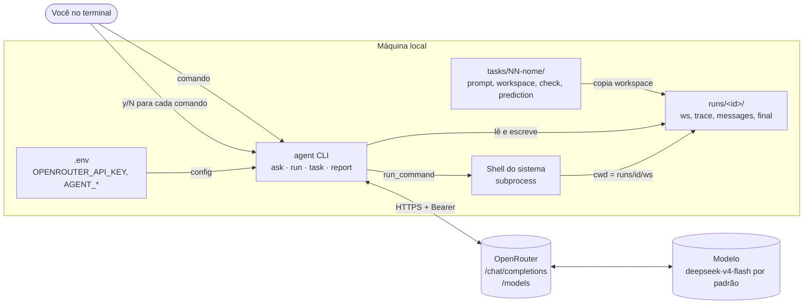
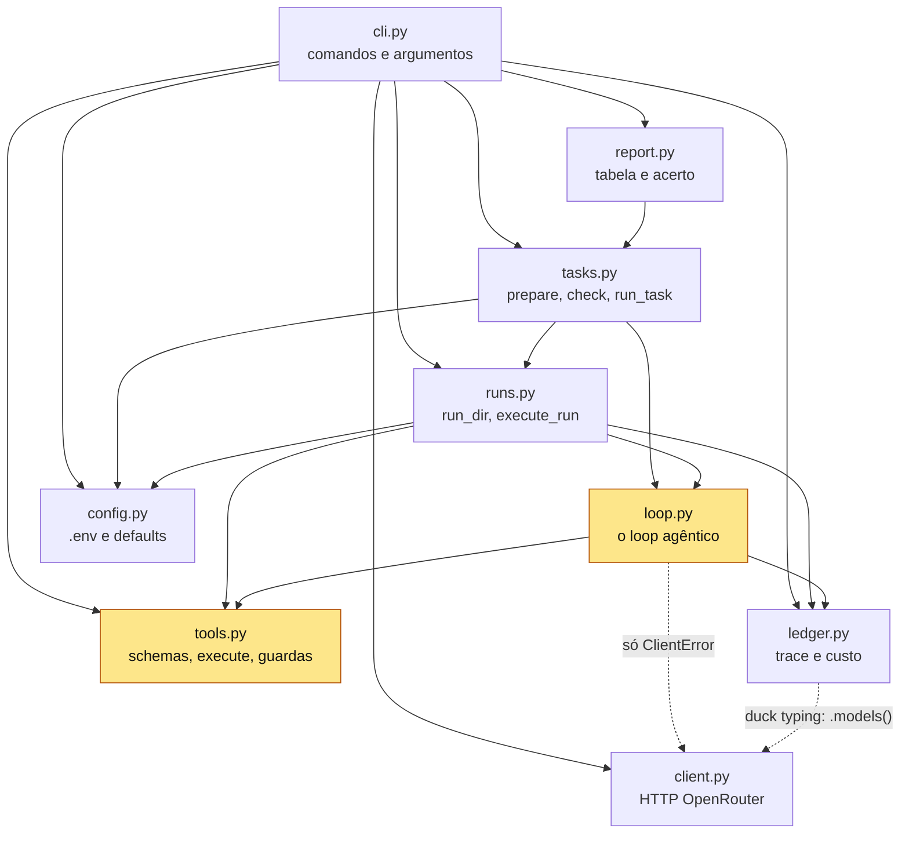
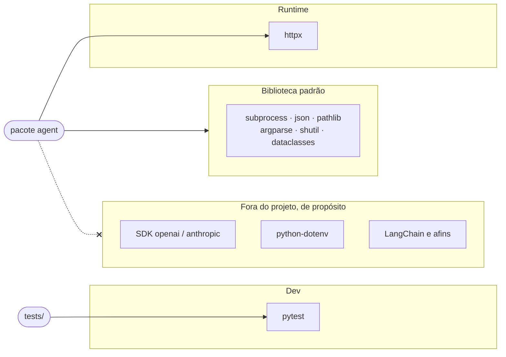

# 1. Visão geral

[← Índice](README.md)

## Contexto

O agente é uma CLI local. Ela conversa com um único serviço externo (o OpenRouter) e age só sobre o disco local, dentro de um workspace descartável.

## Dependências entre módulos

Cada seta é um `import`. O `loop` não importa o cliente concreto: recebe qualquer objeto com `.chat()`, e por isso os testes usam um cliente falso.

O núcleo do estudo (amarelo) são `loop.py` e `tools.py`: juntos têm cerca de 300 linhas.

## Dependências externas

| Módulo | Linhas | Responsabilidade |
|---|---|---|
| `config.py` | 70 | Lê `.env` (parser próprio) e o ambiente; o ambiente vence |
| `client.py` | 148 | `chat()` e `models()`; retry em 429, 5xx e falha de rede |
| `tools.py` | 170 | 3 ferramentas, schemas e guardas |
| `loop.py` | 136 | Chama o modelo, executa `tool_calls`, decide quando parar |
| `ledger.py` | 141 | Grava eventos em JSONL e soma o custo |
| `runs.py` | 77 | Cria `runs/<id>/` e salva `messages.json` e `final.txt` |
| `tasks.py` | 105 | Descobre, prepara e verifica tarefas |
| `report.py` | 185 | Compara previsão e resultado |
| `cli.py` | 209 | Liga tudo atrás de `argparse` |
