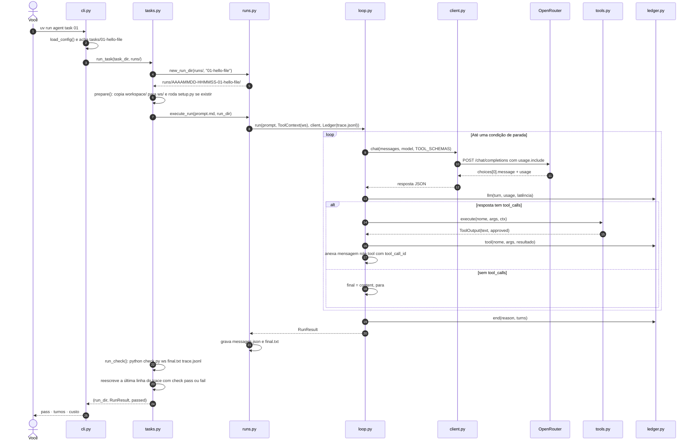
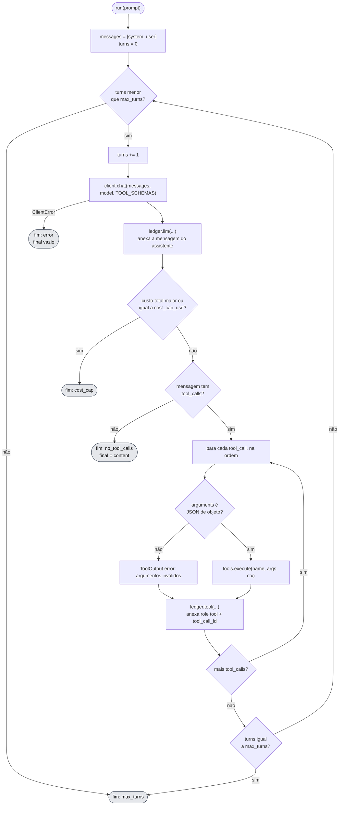
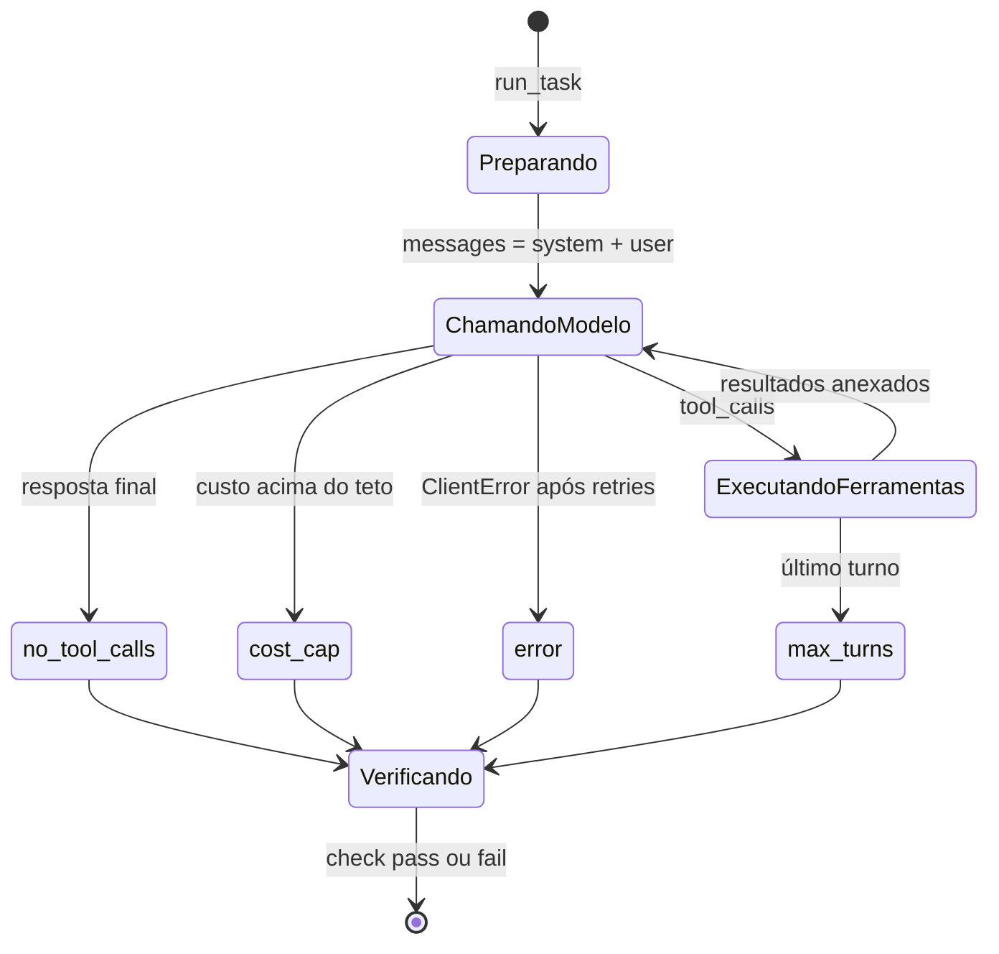

# 2. Fluxo de execução

[← Índice](README.md)

## `agent task 01` de ponta a ponta

## O loop, passo a passo

Este é o coração do projeto (`agent/loop.py`, função `run`).

Dois detalhes que costumam surpreender:

- O teto de custo é checado **depois** da chamada e **antes** de executar ferramentas. Se ele estoura, as `tool_calls` daquela resposta ficam sem resposta em `messages.json`.
- No fim por `max_turns`, as ferramentas do último turno já rodaram, mas o modelo nunca vê o resultado delas.

## Estados de uma execução

Só no `agent task` existe o estado `Verificando`. No `agent run` a execução termina no motivo do fim.

> **Divergência conhecida (passo 12):** o `SYSTEM_PROMPT` lista só `read_file` e `write_file`. O `run_command` está nos schemas, então o modelo pode usá-lo, mas o prompt não o apresenta.
