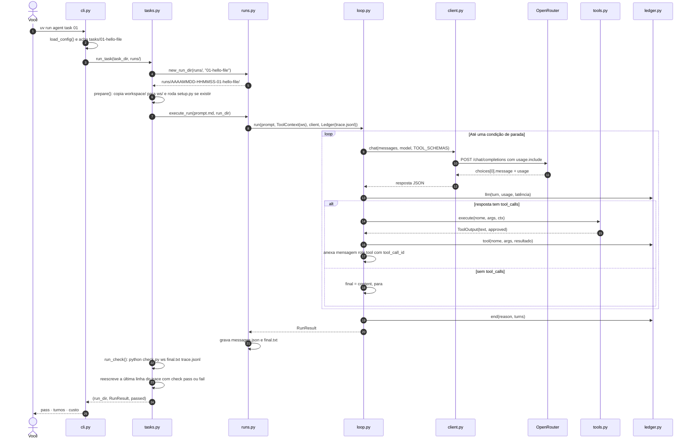
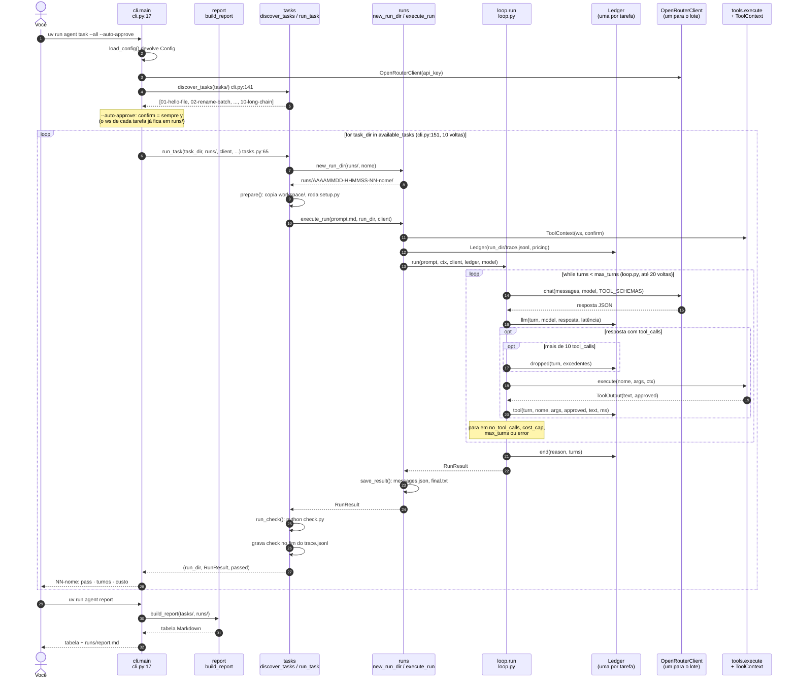
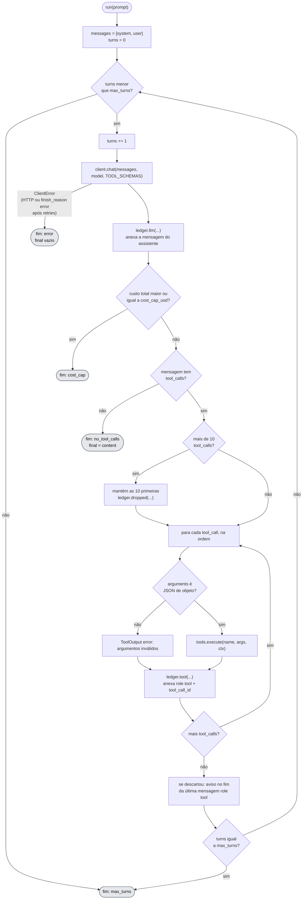
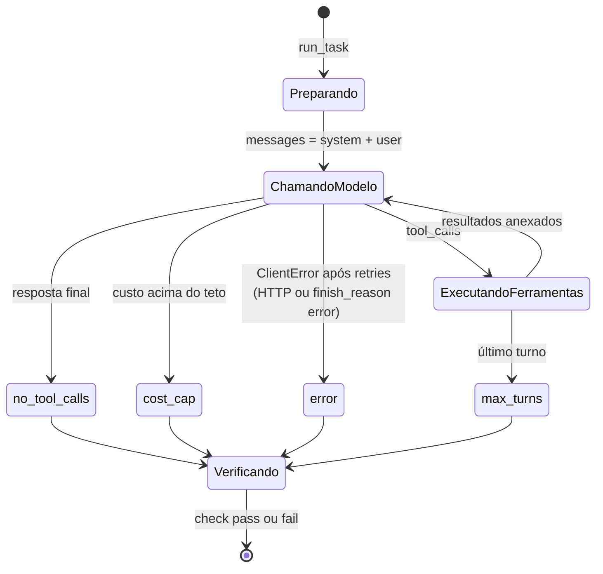

# 2. Fluxo de execução

[← Índice](README.md)

## `agent task 01` de ponta a ponta

## `agent task --all` de ponta a ponta, por classe

Cada participante é um módulo (função) ou uma instância de classe, com o arquivo e a linha onde está. Os dois `loop` do diagrama são os dois laços do código: o de fora percorre as tarefas e o de dentro percorre os turnos com o modelo.

O que muda e o que se repete a cada tarefa:

| Objeto | Quantos no lote | Por quê |
|---|---|---|
| `Config` | 1 | Lida uma vez no início |
| `OpenRouterClient` | 1 | A mesma conexão HTTP serve todas as tarefas |
| `ToolContext` | 10 | Cada tarefa tem o seu `ws/` |
| `Ledger` | 10 | Cada tarefa tem o seu `trace.jsonl` e o seu teto de custo |
| `RunResult` | 10 | Um por execução do loop |

Uma falha do modelo numa tarefa não interrompe o lote: o `run_task` devolve `passed=False` e o laço segue. Já uma exceção no `setup.py` de uma tarefa interrompe o lote, porque o `prepare` usa `check=True` e ninguém captura o erro.

## O loop, passo a passo

Este é o coração do projeto (`agent/loop.py`, função `run`).

Dois detalhes que costumam surpreender:

- O teto de custo é checado **depois** da chamada e **antes** de executar ferramentas. Se ele estoura, as `tool_calls` daquela resposta ficam sem resposta em `messages.json`.
- No fim por `max_turns`, as ferramentas do último turno já rodaram, mas o modelo nunca vê o resultado delas.
- Quando uma resposta traz mais de 10 `tool_calls`, as excedentes são removidas da própria mensagem do assistente antes de executar, para que toda chamada no histórico tenha a sua resposta `role: tool`. O modelo só fica sabendo do corte pelo aviso `[harness: N chamadas descartadas ...]`.

## Estados de uma execução

Só no `agent task` existe o estado `Verificando`. No `agent run` a execução termina no motivo do fim.
