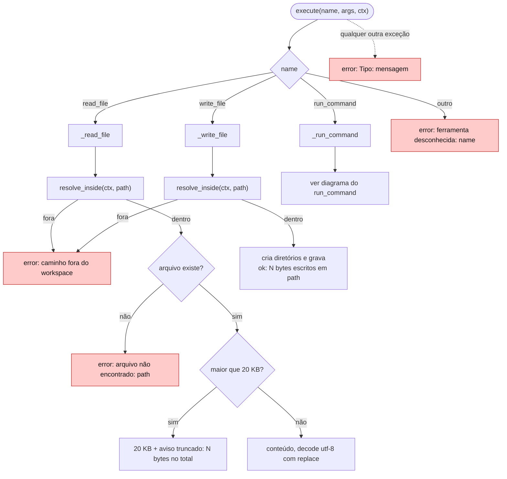
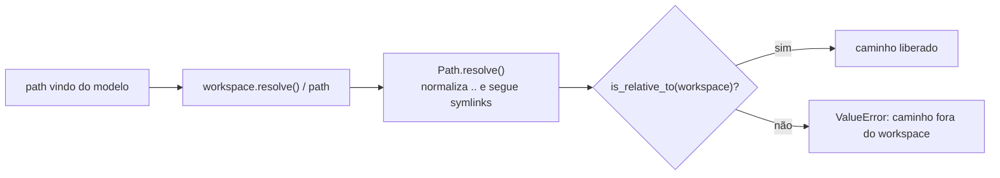
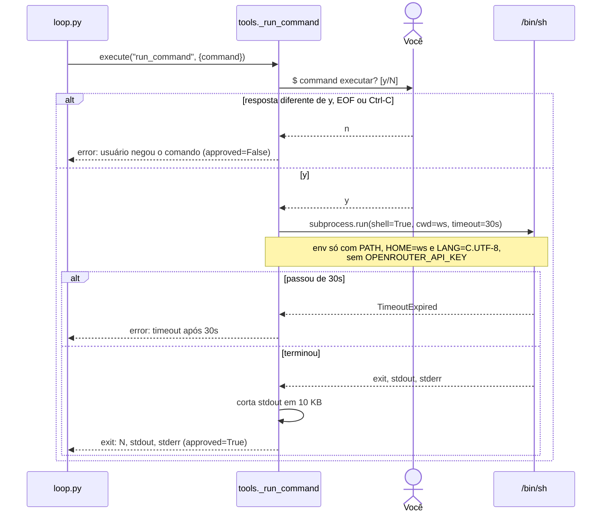
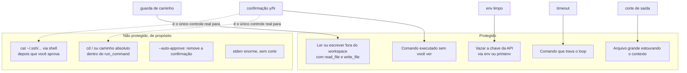

# 3. Ferramentas e guardas

[← Índice](README.md)

## Despacho de uma `tool_call`

`tools.execute(name, args, ctx)` nunca levanta exceção para o loop: todo erro vira texto começando com `error: `, que o modelo lê como resultado da ferramenta.

## Guarda de caminho

| Entrada | Resultado |
|---|---|
| `notas/a.txt` | liberado |
| `../segredo.txt` | bloqueado (`..` sai do workspace) |
| `/etc/passwd` | bloqueado (absoluto: o `/` descarta o workspace na junção) |
| `link` apontando para fora | bloqueado (`resolve()` segue o symlink) |

Essa guarda vale só para `read_file` e `write_file`. O `run_command` não passa por ela.

## `run_command`

## O que as guardas protegem, e o que não

O isolamento de verdade (container, `sandbox-exec`) fica para a Fase 4 do roadmap.

> **Divergências conhecidas (passo 12):**
> - o `stderr` não é cortado; a spec pede 10 KB por fluxo;
> - no `agent task --auto-approve`, a checagem recebe `runs/check/ws`, que está sempre dentro de `runs/`, então nunca recusa. O workspace real das tarefas também fica em `runs/`, então o efeito prático é o mesmo, mas a checagem não testa nada.
