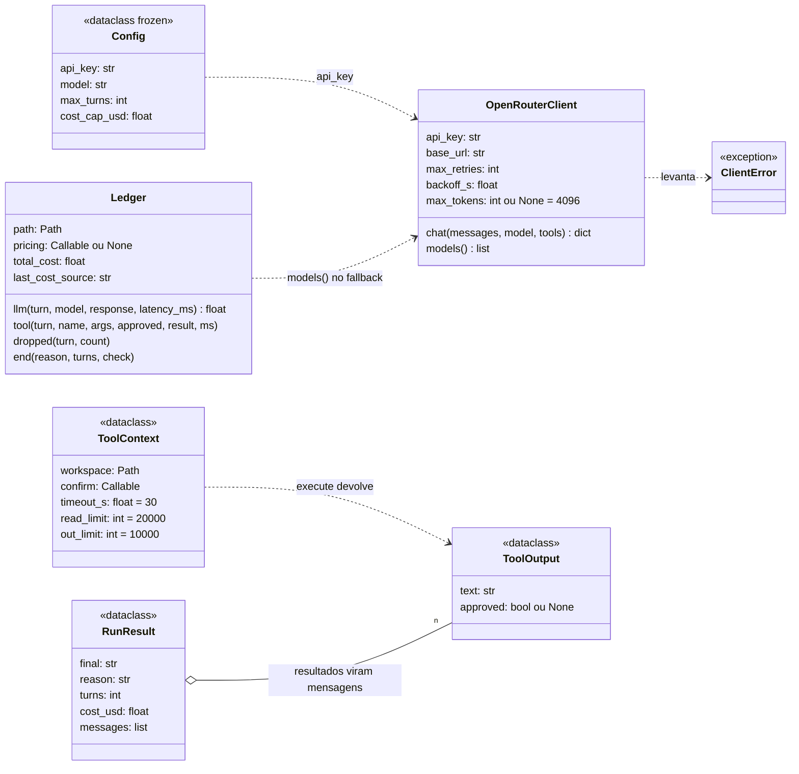
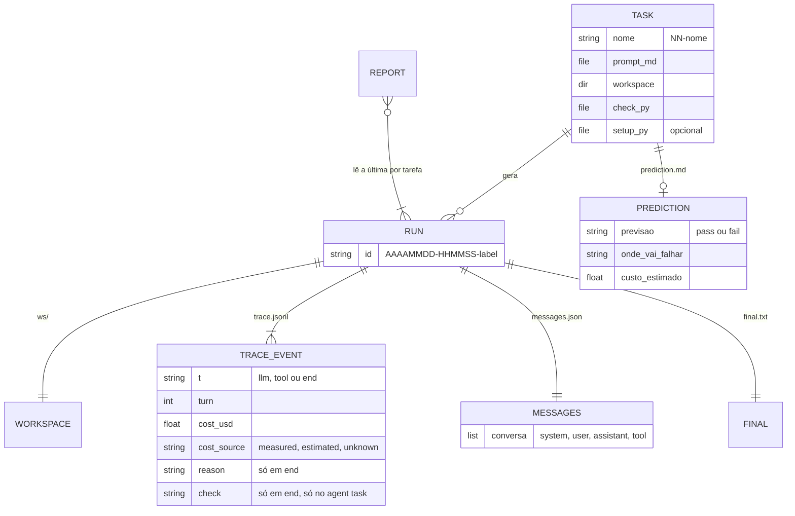
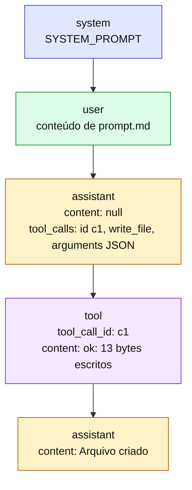

# 4. Modelo de dados

[← Índice](README.md)

## Classes e dataclasses



`approved` vale `None` para `read_file` e `write_file`, `True` ou `False` para `run_command`.

## O que fica gravado em `runs/`



Estrutura em disco:

```
runs/
├── .models-cache.json          # tabela de preços (fallback de custo)
├── report.md                   # saída do agent report
└── 20261102-151542-01-hello-file/
    ├── ws/                     # cópia de tasks/01-hello-file/workspace/, onde o agente trabalha
    ├── trace.jsonl             # um evento por linha
    ├── messages.json           # a conversa completa
    ├── final.txt               # a última resposta do modelo
    └── segredo.txt             # só na tarefa 09, criado pelo setup.py
```

## Protocolo de mensagens

O formato é o da API de chat da OpenAI, que o OpenRouter repassa ao modelo. Uma execução com uma ferramenta fica assim:



Regras que o loop precisa cumprir, senão o provedor recusa a próxima chamada:

1. A mensagem do assistente com `tool_calls` é anexada como veio.
2. Cada `tool_call` recebe exatamente uma mensagem `role: tool` com o mesmo `tool_call_id`, na ordem.
3. A conversa inteira é reenviada a cada turno. É por isso que o custo cresce mais rápido que o número de turnos, e por isso o cache de prompt (`cached_tokens`) importa.
