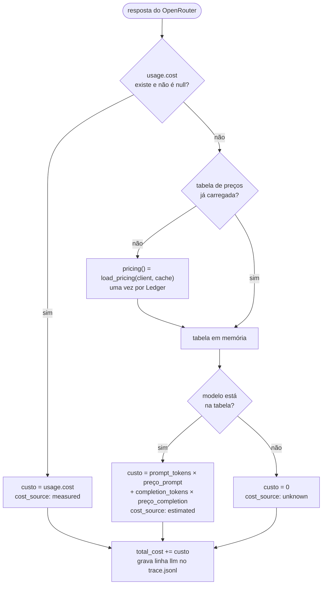
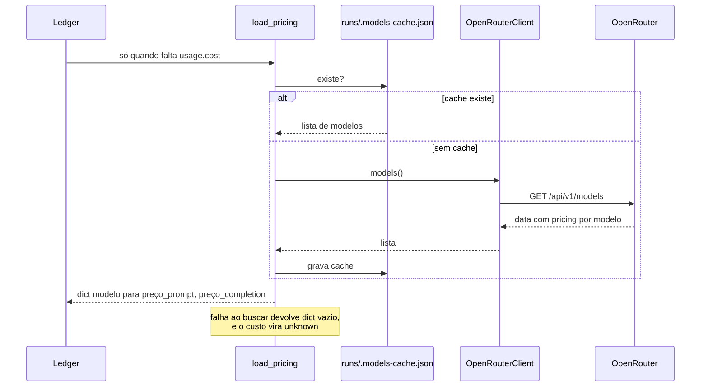
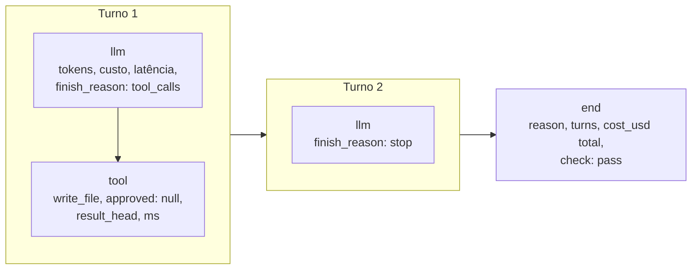

# 5. Custo e ledger

[← Índice](README.md)

## De onde vem o custo de cada chamada

`Ledger.llm()` decide a origem do número e a registra em `cost_source`, para você sempre saber se o custo é medido ou estimado.



O `"usage": {"include": true}` em toda requisição é o que pede ao OpenRouter para devolver `usage.cost`.

## Cache da tabela de preços



O cache nunca expira. Se os preços mudarem, apague `runs/.models-cache.json`.

## Eventos do trace



| Evento | Campos |
|---|---|
| `llm` | `turn`, `model`, `prompt_tokens`, `completion_tokens`, `cached_tokens`, `cost_usd`, `cost_source`, `latency_ms`, `finish_reason` |
| `tool` | `turn`, `name`, `args`, `approved`, `result_head` (500 caracteres), `result_bytes`, `ms` |
| `end` | `reason`, `turns`, `cost_usd` (total), `check` (só no `agent task`) |

O `check` é acrescentado depois: `run_task` roda o `check.py` e reescreve a última linha do trace.

## Por que o custo cresce

A cada turno a conversa inteira é reenviada, então `prompt_tokens` cresce turno a turno mesmo quando o modelo escreve pouco (valores ilustrativos):

```
turno 1: system + user                                  → ~400 tokens de entrada
turno 2: system + user + assistant + tool               → ~550
turno 3: ... + assistant + tool                         → ~700
```

O custo de uma tarefa é aproximadamente quadrático no número de turnos. O `cached_tokens` mostra quanto desse prefixo repetido o provedor cobrou com desconto.
