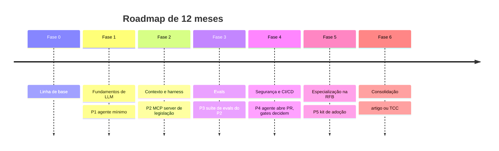
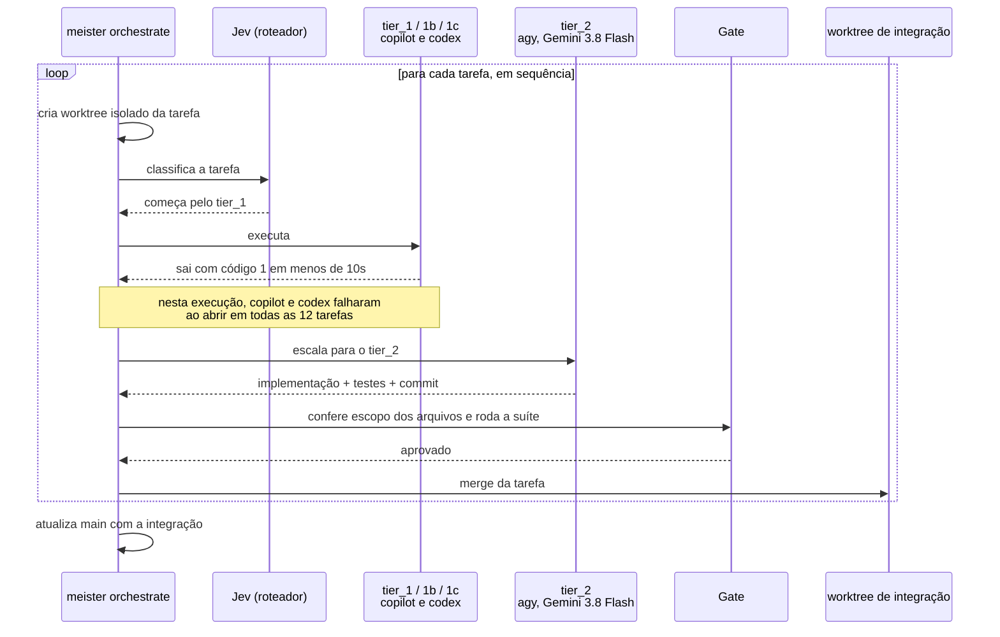
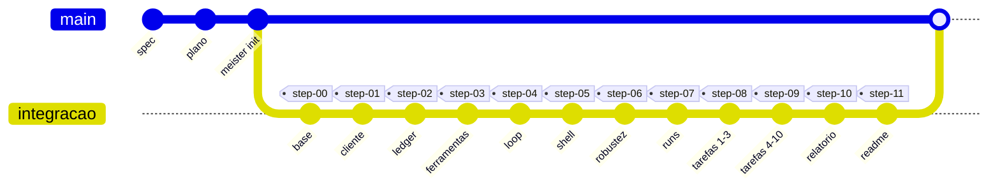
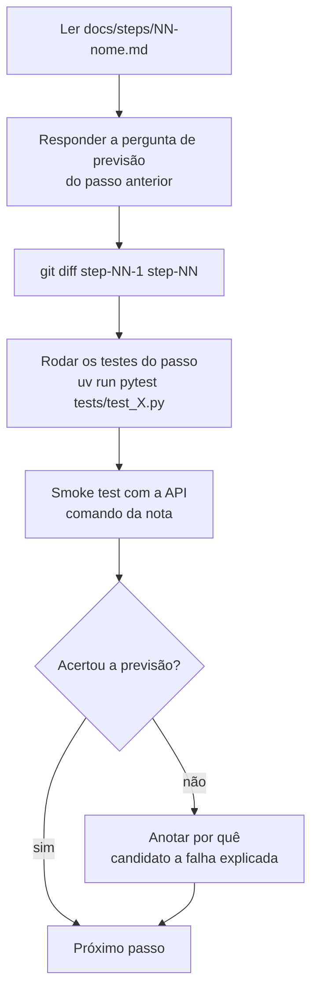
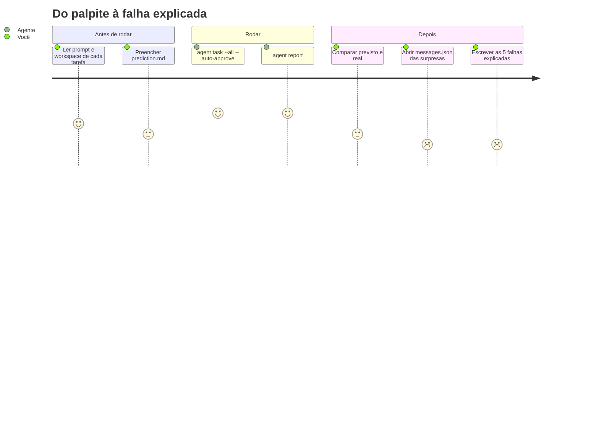

# 7. Processo

[← Índice](README.md)

## Onde o P1 está no roadmap

## Da ideia ao código

```mermaid
flowchart LR
    a["Roadmap<br/>claude.ai"] --> b["Brainstorming<br/>decisões uma a uma"]
    b --> c["Spec<br/>docs/superpowers/specs/"]
    c --> d["Plano de 12 tarefas<br/>docs/superpowers/plans/"]
    d --> e["plan.json<br/>meister plan import"]
    e --> f["meister orchestrate"]
    f --> g["main + tags step-00 a step-11"]
    g --> h["Revisão<br/>117 testes, 7 desvios"]
    h --> i["Passo 12<br/>correções"]
```

## Como o Meister executou cada passo

Cada tarefa levou de 5 a 23 minutos no `tier_2`, cerca de 2 horas no total.

## Histórico git

Simplificação: na prática, cada passo veio de um worktree próprio e entrou na integração com um merge.

## Como estudar cada passo

## O ciclo de medição do P1

As notas de 1 a 5 indicam o esforço esperado: quanto menor, mais trabalho. A parte difícil, e a que vale o projeto, é a última seção.
