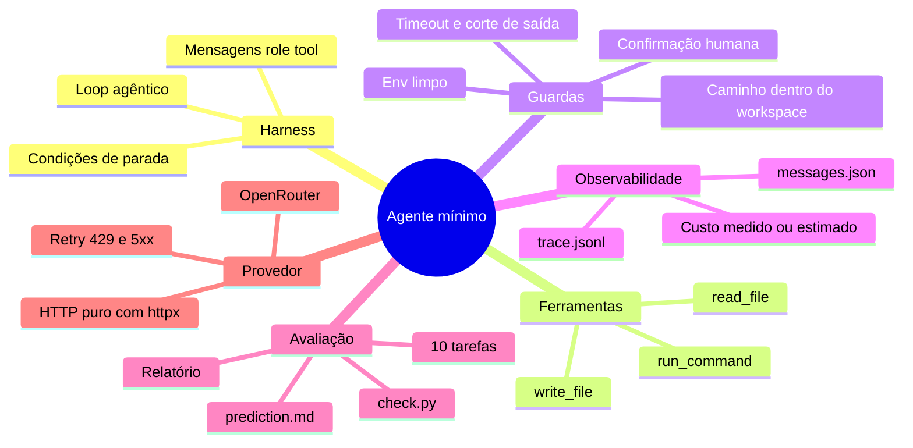

# Arquitetura do agente mínimo

Páginas complementares ao [README](../../README.md), com diagramas Mermaid de como o projeto funciona. Os diagramas descrevem o código da tag `step-11`; onde o código diverge da [spec](../superpowers/specs/2026-11-02-p1-agente-minimo-design.md), a página avisa.

| Página | Pergunta que responde | Diagramas |
|---|---|---|
| [1. Visão geral](01-visao-geral.md) | Quais são as peças e quem depende de quem? | contexto, dependências entre módulos, dependências externas |
| [2. Fluxo de execução](02-fluxo-de-execucao.md) | O que acontece quando rodo `agent task 01` ou `agent task --all`? | sequência de uma tarefa, sequência do lote por classe, fluxograma do loop, estados de parada |
| [3. Ferramentas e guardas](03-ferramentas-e-guardas.md) | Como uma `tool_call` vira efeito no disco, e o que a impede? | despacho, guarda de caminho, `run_command` |
| [4. Modelo de dados](04-modelo-de-dados.md) | Que estruturas existem e o que fica gravado? | classes, entidades de `runs/`, protocolo de mensagens |
| [5. Custo e ledger](05-custo-e-ledger.md) | De onde vem cada número de custo? | decisão de custo, cache de preços |
| [6. Tarefas e avaliação](06-tarefas-e-avaliacao.md) | Como uma tarefa é preparada, verificada e relatada? | `run_task`, mapa das armadilhas, relatório |
| [7. Processo](07-processo.md) | Como o projeto foi construído e como estudá-lo? | Meister, histórico git, ciclo de estudo |

## Mapa de conceitos

